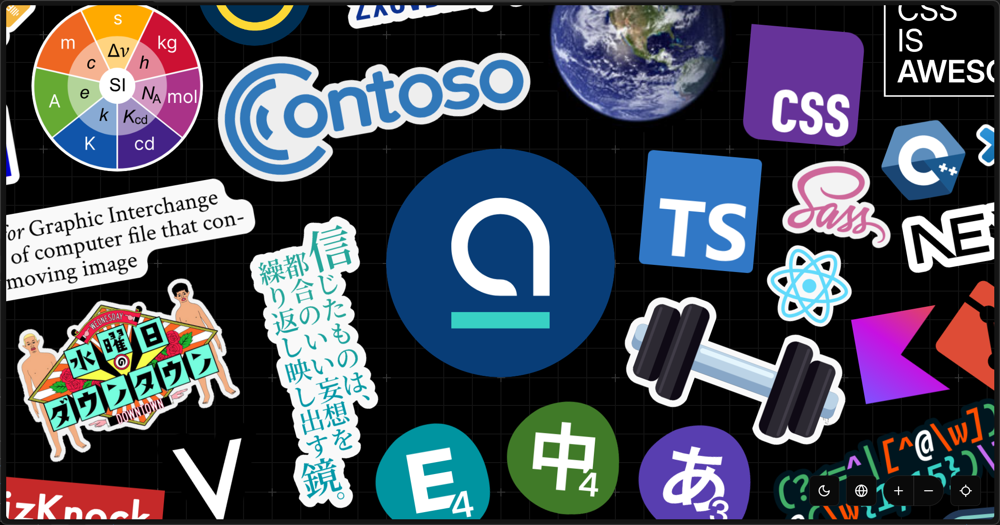

# Sticker Sheet



**Sticker Sheet** is an innovative About-me page, but full of interactive stickers. Create a personalized canvas with stickers that represent your identity, interests, and skills.

## Features

- A sticker canvas with zooming and panning support.
- Dark / light mode
- Fully localizable: name, description, and even stickers themselves
- Dynamic stickers running JavaScript logic
- MDX and React components in descriptions

## Getting Started

### Prerequisites

- Node.js, npm

### Installation

1. Clone the repository:
   ```bash
   git clone https://github.com/blueset/sticker-sheet.git
   cd sticker-sheet
   ```

2. Install dependencies:
   ```bash
   npm install
   ```

3. Run the development server:
   ```bash
   npm run dev
   ```

4. Open [http://localhost:4321](http://localhost:4321) in your browser to see the result.

## Architecture

The site is a static [Astro 7](https://astro.build) build (`output: "static"`) for GitHub Pages: `npm run build` writes plain files to `dist/`, with no server code.

- **First paint without JavaScript.** `src/pages/index.astro` prerenders every sticker (`src/components/Sticker.astro`) as positioned DOM with its image, title and clip path.
- **Inline boot scripts.** Small inline scripts from `src/inline/` run before first paint:
  - `boot-head.ts` sets the theme and language.
  - `boot-view.ts` computes the initial view (centring a `/#slug` sticker) and fills the live (date) values.
  - `boot-fonts.ts` loads the CJK fonts.
- **Viewer.** `src/viewer/` is framework-free TypeScript:
  - `main.ts` is the only eager module script.
  - `controller.ts` handles pan, zoom and inertia.
  - `interactions.ts` handles clicks and hit-testing that agrees with each sticker's clip path.
  - `deeplink.ts` handles `/#slug`.
  - `prefetch.ts` does a bounded idle prefetch of descriptions.
- **React islands.** `src/islands/` has two islands, both hydrated at `client:idle`:
  - `Controls.tsx`: zoom, theme and language buttons (Radix).
  - `Sheet.tsx`: the description sheet (Silk).
- **Build-time stickers and MDX.**
  - `src/lib/stickers.ts` loads `src/data/stickers/*.yaml` at build time.
  - `src/lib/mdx/` compiles each description to its own lazily loaded chunk per language through a Vite plugin (`vite-plugin.ts`), including the dynamic (live) expressions.
  - Shared state and helpers live in `src/lib/`; styles in `src/styles/`.
- **Asset pipeline.** `npm run optimize-assets [--dry-run] [file ...]` (`scripts/optimize-assets.ts`) minifies `public/stickers/*.svg` and re-encodes embedded rasters to WebP, and writes WebP siblings for PNGs. Every change is gated by a pixel comparison and recorded in `optimized-assets.json`.

Design and numbers: `docs/superpowers/specs/2026-11-20-render-performance-design.md`, `docs/superpowers/decisions/`.

## Commands

| Command | What it does |
|---|---|
| `npm run dev` | Astro dev server on http://localhost:4321 |
| `npm run build` | Static build to `dist/` |
| `npm run preview` | Serve the built `dist/` |
| `npm test` | Unit tests (Vitest) |
| `npm run check` | `astro check` (type check) |
| `npm run test:e2e` | Playwright e2e on all four projects (`chromium-desktop`, `chromium-mobile`, `webkit-mobile`, `firefox-desktop`); build first. It serves `STATIC_DIR` (default `dist`) on port 4173 |

Playwright reads three environment variables:
- `TARGET` (`new`, the default, or `baseline`) picks the selector contract.
- `STATIC_DIR` picks the directory to serve.
- `VISUAL_MAX_DIFF` sets the screenshot tolerance (default 0, an exact match).

Visual comparison against the committed snapshots (never pass `--update-snapshots`):

```powershell
$env:TARGET='new'; $env:STATIC_DIR='dist'; $env:VISUAL_MAX_DIFF='0.01'
npx playwright test tests/visual --project=chromium-desktop
npx playwright test tests/visual --project=chromium-mobile
```

Benchmarks (Chromium only; about a minute per first-render profile, a few minutes per gestures profile). Each bench writes `bench/results/<TARGET or BENCH_LABEL>-<profile>.json`:

```powershell
$env:BENCH='1'; $env:TARGET='new'; $env:STATIC_DIR='dist'
npx playwright test bench/first-render.bench.ts --project=chromium-mobile
npx playwright test bench/gestures.bench.ts --project=chromium-mobile
# same with --project=chromium-desktop
```

## Baseline vs new

- **The baseline.** The render-performance rewrite is measured against the previous Next.js app.
  - `.baseline-site/` (git-ignored) is a copy of that app's unchanged static export (`out/` from `next build` at commit `c4ab84c`). Recreate it by checking that commit out in a separate worktree, running `npm install` and `npm run build`, then copying `out` to `.baseline-site`.
  - Serve and test it with `TARGET=baseline` and `STATIC_DIR=.baseline-site`. For the first-render bench also set `BENCH_PAYLOAD_GATE=0`, because the baseline fails the payload gate by design.
- **Baseline results.** `bench/results/baseline-{mobile,desktop}.json` are the tracked Milestone 0 numbers (`docs/superpowers/baseline/report.md`). Do not overwrite them: a bench run with `TARGET=baseline` writes to the same names. Use a `BENCH_LABEL`, or restore them with `git checkout -- bench/results/baseline-*.json`.
- **New-build results.** `bench/results/m1-{mobile,desktop}.json` are the new build's numbers at the end of Milestone 1, with first-render and gesture runs together. They are copies of the generated `new-*.json`. The comparison is in `docs/superpowers/decisions/002-m1-numbers.md`.

## Adding Your Own Stickers

Stickers are defined in YAML files in the `src/data/stickers` directory. They are loaded directly at build time; there is no separate compile step.

To add a new sticker:

1. Create a new YAML definition in `src/data/stickers/`
1. Add your sticker image (if any) to `public/stickers/`

Example sticker definition:

```yaml
slug: my-sticker
x: 500
y: 300
width: 200
height: 200
rotation: 10 # degrees clockwise
image: /stickers/my-sticker.svg
title: 
  en: "My Sticker"
  ja: "私のステッカー"
description:
  en: "This is my custom sticker"
  ja: "これは私のカスタムステッカーです"
```

## License

MIT License.
